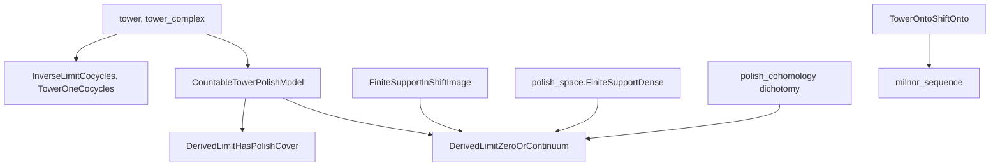

# derived_limit — lim and lim¹ of a tower of modules as the cohomology of a two-term Polish complex

A tower is a sequence of modules on one host type with a homomorphism from each to the one below. Its two-term complex has the sequences in degrees zero and one, id − shift as the differential and zero above: the inverse limit is the kernel, the compatible sequences, and the derived limit lim¹ is the cokernel, the first cohomology. Nothing here is new homological algebra: the complex is a complex_ops record and lim¹ is chain_complex's cohomology of it, so every mechanism of [polish_cohomology](../polish_cohomology/README.md) applies to it as stated.

For a tower of countable modules the sequences form a countable product of countable discrete groups, the degrees are Polish by polish_group.DiscreteProductGroupPolish and id − shift is continuous since each output reads two coordinates, so lim¹ carries its Polish cover: the sequence group over the actual image of id − shift. The finitely supported sequences lie in that image and are dense; with the dichotomy of [borel_subgroup](../../group/borel_subgroup/README.md) read through polish_cohomology this is Gray's theorem, lim¹ is zero or has at least continuum many elements. For a tower of surjections id − shift is onto and lim¹ is zero. The worked example of a nonzero lim¹ is the tower of the integers under doubling, whose lim¹ is ℤ₂/ℤ: [dyadic_integers](../dyadic_integers/README.md).

All theorem members here are cards. To read their exact statements and dependencies, run `xugo query family algebra/module/derived_limit`.

## Members

| Member | Status | Statement and purpose |
|---|---|---|
| `TowerDef` | definition | A descending sequence of modules on one host type with homomorphisms from each to the one below. |
| `TowerOntoDef` | definition | Every transition map of the tower is onto. |
| `towerZeroDef` | definition | The sequence of the coordinate zeroes. |
| `SequenceModuleDef` | definition | The product of the sequence of modules, with pointwise operations; every coordinate is active. |
| `TowerShiftDef` | definition | The map id − shift of a tower, read at one coordinate. |
| `TowerTermsDef` | definition | Degrees zero and one are the sequences; above, only the zero sequence. |
| `TowerComplexDef` | definition | The two-term cochain complex of a tower: id − shift in degree zero, zero above. |
| `TowerTopologiesDef` | definition | The product of the discrete coordinate modules in degrees zero and one, the one-point topology above. |
| `InverseLimitDef` | definition | The compatible sequences, as a set. |
| `DerivedLimitDef` | definition | lim¹ as the first cohomology of the two-term complex. |
| `TowerComplexCochain` | card | The two-term complex of a tower is a cochain complex. |
| `InverseLimitCocycles` | card | The 0-cocycles of the tower complex are the compatible sequences. |
| `TowerOneCocycles` | card | Every 1-cochain is a cocycle and the 1-coboundaries are the image of id − shift. |
| `CountableTowerPolishModel` | card | A tower of countable modules gives a Polish cochain model, by DiscreteProductGroupPolish and FiniteCoordinateContinuous. |
| `DerivedLimitHasPolishCover` | card | lim¹ of a tower of countable modules has a Polish cover: the sequence group over the image of id − shift. |
| `FiniteSupportInShiftImage` | card | A finitely supported sequence is in the image of id − shift, by a downward recursion. |
| `TowerOntoShiftOnto` | card | For a tower of surjections, id − shift is onto the sequences. |
| `DerivedLimitZeroOrContinuum` | card | Gray: lim¹ of a tower of countable modules is zero or has at least continuum many elements. |

## Polish towers

The Polish tower interface permits nondiscrete stage groups, provided transitions are continuous. Products, limits and id-minus-shift retain their actual topologies. Finite-support density gives the same zero-or-continuum alternative.

| Member | Status | Statement and purpose |
|---|---|---|
| `PolishTowerDef` | definition | A tower of modules whose additive groups are Polish and whose transitions are continuous. |
| `PolishTowerTopologiesDef` | definition | The two nonzero tower degrees use the supplied Polish factors; later degrees have only the zero sequence. |
| `PolishTowerModel` | card | Products are Polish; id minus shift reads two coordinates continuously. — card |
| `PolishInverseLimitClosed` | card | The inverse limit is the closed kernel of the continuous id-minus-shift homomorphism. — card |
| `PolishDerivedLimitZeroOrContinuum` | card | FiniteSupportInShiftImage and ProductFiniteSupportDense make the boundary subgroup dense. — card |
