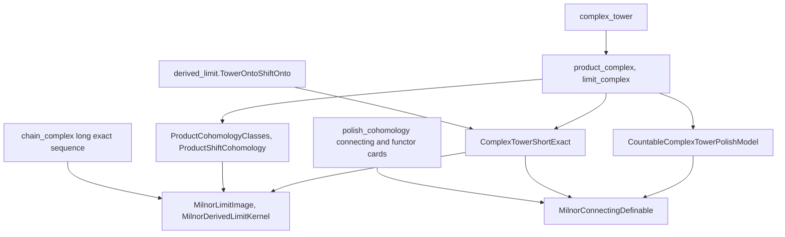

# milnor_sequence — towers of cochain complexes: the product and limit complexes, the Milnor sequence and its Borel lifts

A tower of cochain complexes on one host type has a product complex, the sequences with pointwise operations and differential, and a limit complex, the compatible sequences, a subcomplex. id − shift is a cochain map of the product to itself whose kernel is the limit; for a tower of degreewise surjections it is onto, and the limit, the product and id − shift form a short exact sequence of complexes, so chain_complex's long exact sequence applies to it.

The cohomology of the product is the product of the cohomologies, a class of the product being the sequence of its coordinate classes, and under that identification id − shift on cohomology is id − shift on the tower of cohomology modules. Milnor's sequence is then two readings of the long exact sequence: the image of H^n of the limit in the product of the H^n is the inverse limit of the cohomology tower, and the connecting map kills a product class exactly when its class sequence is in the image of id − shift, so lim¹ of the cohomology tower injects into $H^{n+1}$ of the limit with image the kernel of the inclusion. The lim and lim¹ terms are [derived_limit](../derived_limit/README.md)'s, on the host type of classes.

For complexes with countable terms the product and limit complexes are Polish models, the inclusion and id − shift continuous, and the connecting map and the inclusion on cohomology have Borel lifts by the mechanism of [polish_cohomology](../polish_cohomology/README.md). The Polish cover of lim¹ of a tower of cohomology groups, each itself a quotient, is not stated: the lim¹ term is read through the kernel of the connecting map.

All theorem members here are cards. To read their exact statements and dependencies, run `xugo query family algebra/module/milnor_sequence`.

## Members

| Member | Status | Statement and purpose |
|---|---|---|
| `ComplexTowerDef` | definition | A descending sequence of cochain complexes on one host type with cochain maps from each to the one below. |
| `ComplexTowerOntoDef` | definition | Every transition map is onto in every degree. |
| `complexZeroSequenceDef` | definition | The sequence of the coordinate zeroes of the complexes. |
| `productTermsDef` | definition | The sequences with the k-th coordinate in the degree-n term of the k-th complex. |
| `ProductComplexDef` | definition | The product of the sequence of complexes, with pointwise operations and differential. |
| `ProductShiftDef` | definition | id − shift on the product complex, read at one degree and coordinate. |
| `limitTermsDef` | definition | The compatible sequences in degree n. |
| `LimitComplexDef` | definition | The limit complex: the compatible sequences with the operations and differential of the product. |
| `productTopologiesDef` | definition | The product of the discrete degree-n terms of the complexes. |
| `limitTopologiesDef` | definition | The subspace topology of the compatible sequences. |
| `CohomologyTowerDef` | definition | The tower of degree-n cohomology modules of the complexes. |
| `CohomologyTowerMapsDef` | definition | The maps on degree-n cohomology induced by the transition maps. |
| `ProductClassMapDef` | definition | A class of the product complex read as the sequence of its coordinate classes. |
| `ProductComplexCochain` | card | The product of cochain complexes is a cochain complex. |
| `LimitComplexCochain` | card | The limit complex is a cochain complex; the transition maps being cochain maps preserves compatibility. |
| `LimitInclusionCochainMap` | card | The inclusion of the limit complex into the product is a cochain map. |
| `ProductShiftCochainMap` | card | id − shift is a cochain map of the product complex to itself. |
| `ComplexTowerShortExact` | card | For a tower of surjections, the limit, the product and id − shift form a short exact sequence of complexes. |
| `ProductCohomologyClasses` | card | The cohomology of the product is the product of the cohomologies, through the class map. |
| `ProductShiftCohomology` | card | Under the class map, id − shift on the cohomology of the product is id − shift on the product of cohomologies. |
| `MilnorLimitImage` | card | The image of the limit cohomology in the product cohomology is the inverse limit of the cohomology tower. |
| `MilnorDerivedLimitKernel` | card | The connecting map kills a product class exactly when its class sequence lies in the image of id − shift: lim¹ injects into the next cohomology of the limit. |
| `CountableComplexTowerPolishModel` | card | A tower of complexes with countable terms gives Polish product and limit models with continuous inclusion and shift. |
| `MilnorConnectingDefinable` | card | The connecting map and the inclusion of a countable tower of surjections have Borel lifts. |

## Polish models and applications

The Polish complex-tower interface permits nondiscrete cochain terms. Degreewise surjectivity gives the same short exact complex sequence and Borel connecting map. In degree one, the lim-one tower of zero cocycles identifies the locally exact classes; the phantom representative subset is Borel, not asserted closed, and has an explicit inverse Borel lift.

| Member | Status | Statement and purpose |
|---|---|---|
| `ZeroCocycleTowerDef` | definition | Degree-zero cocycles with their actual additive and scalar operations. |
| `MilnorZeroConnectingDef` | definition | The Milnor connecting map on the lim-one presentation of the zero-cocycle tower; well-definedness and injectivity are theorem conclusions. |
| `milnorPhantomRepresentativesDef` | definition | Compatible degree-one cocycles that are boundaries at every stage. |
| `ZeroCocyclePolishTower` | card | Zero cocycles are closed kernels in every stage and the transition maps preserve them continuously. — card |
| `PolishMilnorPhantom` | card | MilnorDerivedLimitKernel identifies exactly the shift denominator in the product of zero cocycles. — card |
| `PolishMilnorPhantomInverse` | card | The phantom representative set need not be closed or Polish in its subspace topology. — card |
| `PolishComplexTowerDef` | definition | Each stage is a Polish cochain complex and each transition is a continuous cochain map. |
| `PolishProductTopologiesDef` | definition | Products use the actual degree topologies, which need not be discrete. |
| `PolishLimitTopologiesDef` | definition | The limit has its closed subspace topology. |
| `PolishComplexTowerModel` | card | Apply ProductGroupPolish degreewise. — card |
| `PolishMilnorConnectingDefinable` | card | The cohomology tower need not consist of Polish groups. — card |
