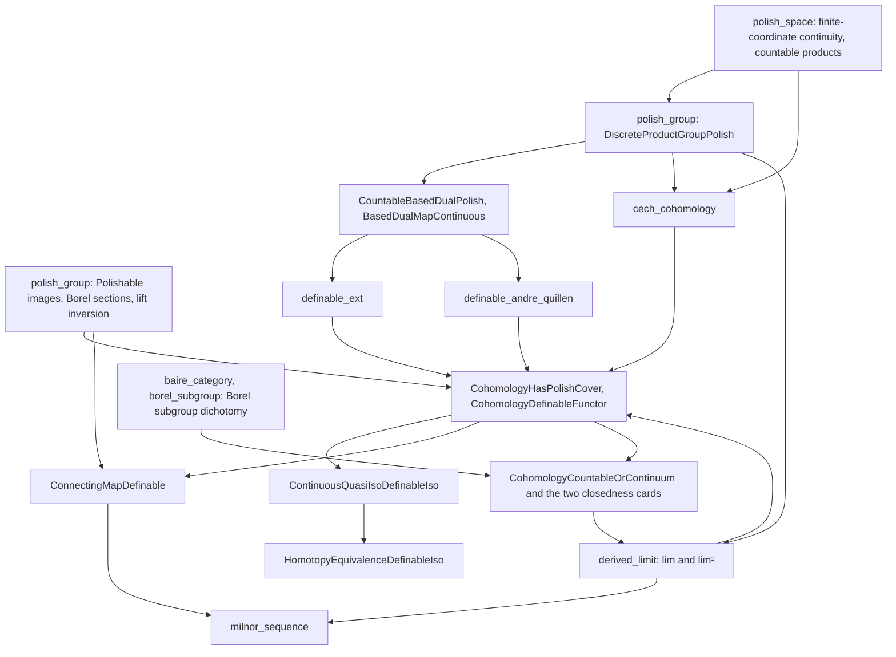

# polish_cohomology — Polish covers of cohomology and regular comparison and connecting maps

The algebraic complex is the existing complex_ops record and the cohomology is chain_complex's quotient carrier. What this chapter adds is regularity: a family of topologies, one per degree, making each term a Polish abelian group and each differential continuous. The cocycles are then a closed, hence Polish, subgroup, the coboundaries a Polishable subgroup of it, and the pair is a Polish cover of the cohomology in the sense of Bergfalk, Lupini and Panagiotopoulos. The quotient retains its actual coboundaries, not their closures. A continuous cochain map restricts to a continuous homomorphism of cocycles, which is a lift of the existing cohomology_map; the maps between covers are these lifts, asked to be Borel, and an isomorphism of covers has Borel lifts in both directions. No continuous inverse is ever asserted.

The chapter is the hub of a programme laid as cards. Below it stand [polish_space](../../../topology/polish_space/README.md), [borel_space](../../../topology/borel_space/README.md), [indexed_functions](../../../sets/indexed_functions/README.md) and [polish_group](../../group/polish_group/README.md), which supply the topologies, the Borel sets, the normalized products and the theorems about continuous homomorphisms of Polish groups. Beside it, [baire_category](../../../topology/baire_category/README.md) and [borel_subgroup](../../group/borel_subgroup/README.md) supply the size dichotomy for a Borel subgroup. Above it stand the applications, [definable_ext](../definable_ext/README.md), [definable_andre_quillen](../../cotangent/definable_andre_quillen/README.md) and [cech_cohomology](../../../topology/cech_cohomology/README.md), each supplying a Polish cochain model to the common mechanism, and the towers, [derived_limit](../derived_limit/README.md) and [milnor_sequence](../milnor_sequence/README.md), lim¹ as a two-term model and Milnor's sequence for a tower of complexes.

## The reusable mechanisms

`CohomologyHasPolishCover` makes every degree of a Polish cochain model a cover: the cocycles are the kernel of a continuous differential, the coboundaries the image of one, Polishable and Borel by polish_group.ContinuousHomImagePolishable, the zero subgroup in degree zero. `CohomologyDefinableFunctor` gives the existing cohomology map of a continuous cochain map its Borel lift, the cochain map restricted to cocycles; the identity and composition laws are chain_complex's, since the map is the ordinary one. `ContinuousQuasiIsoDefinableIso` inverts a continuous comparison that induces the ordinary isomorphism in a degree, by polish_group.ContinuousLiftBijectiveIso applied to that lift with the coboundaries presented as the image of the preceding differential. `HomotopyEquivalenceDefinableIso` is the comparison interface: two models compared by a continuous cochain homotopy equivalence have Borel-isomorphic covers in every degree, the homotopies being algebraic data, by chain_complex.CochainHomotopyEquivalenceIsomorphism. `ConnectingMapDefinable` gives the existing coconnecting_hom of a short exact sequence of Polish models a Borel lift, from two Borel sections by polish_group.ContinuousSurjectionBorelSection, one of the projection and one of the inclusion onto its closed image; the long exact sequence and its naturality are chain_complex's.

`CountableBasedDualPolish` and `BasedDualMapContinuous` are the model constructor the applications share: the free dual of a based chain complex with countable bases and countable discrete coefficients is a Polish model, and the transpose of a chain map is continuous. Their terms are the normalized products of polish_space's indexed_discrete_topology, Polish abelian groups by polish_group.DiscreteProductGroupPolish, and their maps read finitely many coordinates at each output, continuous by polish_space.FiniteCoordinateContinuous.

## The size of a cover

The coboundaries are a Borel subgroup of the Polish cocycle group, so borel_subgroup's dichotomy reads at them. `CohomologyCountableOrContinuum`: the cohomology of a Polish cochain model is countable or has at least continuum many classes, the continuum spelled as the subsets of ℕ. `CountableCohomologyClosedCoboundaries`: countable cohomology makes the coboundaries open and closed in the cocycles. `NonclosedCoboundariesContinuumCohomology`: coboundaries that are not closed give the continuum. The applications state the dichotomy for Ext, André–Quillen cohomology and countable-cover Čech cohomology; derived_limit reads it as Gray's theorem, lim¹ is zero or of the size of the continuum.

The arrows show the construction route: the supporting chapters supply the topological theorems, every application and tower supplies a Polish cochain model to the common mechanism, and the dichotomy reads at every model. The registry records the individual statement dependencies.

Ext uses the canonical free resolution, AQ the standard cotangent resolution through the existing CotangentScalarBased and CotangentDualAgreement cards, and Čech a specified countable cover; the Čech chapter does not identify arbitrary cover cohomology with sheaf cohomology. A comparison between two presentations enters through HomotopyEquivalenceDefinableIso as a continuous cochain homotopy equivalence, as definable_ext's ExtResolutionDefinableIso does for two countable resolutions. The towers put the sequences of a tower on the same normalized-product carrier as the based duals, so lim¹ is one more model and Milnor's sequence two readings of the long exact sequence.

All theorem members here are cards. To read their exact statements and dependencies, run `xugo query family algebra/module/polish_cohomology`.

## Members

| Member | Status | Statement and purpose |
|---|---|---|
| `PolishCochainComplexDef` | definition | Each degree topology is on exactly that degree carrier; scalar multiplication need not be jointly continuous in the scalars. |
| `PolishCochainMapDef` | definition | A cochain map continuous in every degree. |
| `CocycleGroupDef` | definition | The additive group of cocycles, with the ambient complex operations. |
| `CocycleTopologyDef` | definition | Cocycles carry the subspace topology of the degree term. |
| `CohomologyCoverDef` | definition | The covering group is the cocycle group and the denominator is the actual coboundary subgroup. |
| `CohomologyBorelMapDef` | definition | A Borel-liftable homomorphism between two cohomology covers, allowing a change of degree. |
| `CohomologyBorelIsoDef` | definition | A comparison with Borel lifts in both directions. |
| `DualPointwiseTopologiesDef` | definition | In each degree, the dual is a product of discrete copies of N on its generators. |
| `CohomologyHasPolishCover` | card | Cocycles are the closed kernel of a continuous differential; coboundaries are the Polishable image of one, or the zero subgroup in degree zero. |
| `CohomologyDefinableFunctor` | card | Restrict f(n) to cocycles; it is a continuous lift of the existing cohomology_map. |
| `ContinuousQuasiIsoDefinableIso` | card | Apply ContinuousLiftBijectiveIso to the restricted cochain map and the specified ordinary isomorphism; the coboundaries are presented by the preceding differential. |
| `HomotopyEquivalenceDefinableIso` | card | A continuous cochain homotopy equivalence induces Borel isomorphisms of covers in both directions; the homotopies are algebraic data. |
| `ConnectingMapDefinable` | card | Use ContinuousSurjectionBorelSection for Borel sections of p and of i onto its closed image; exactness makes their composite with the middle differential a lift. |
| `CountableBasedDualPolish` | card | DiscreteProductGroupPolish gives Polish terms; finite supports and FiniteCoordinateContinuous give continuity of the transpose differential. |
| `BasedDualMapContinuous` | card | FiniteCoordinateContinuous applies to the transpose because each generator has a finite expansion after the chain map. |
| `CountableCohomologyClosedCoboundaries` | card | Countable cohomology forces the coboundaries to be open and closed in the cocycles, by CountableIndexBorelSubgroupClopen. |
| `NonclosedCoboundariesContinuumCohomology` | card | Coboundaries that are not closed give at least continuum many classes. |
| `CohomologyCountableOrContinuum` | card | The cohomology of a Polish cochain model is countable or has at least continuum many classes. |
